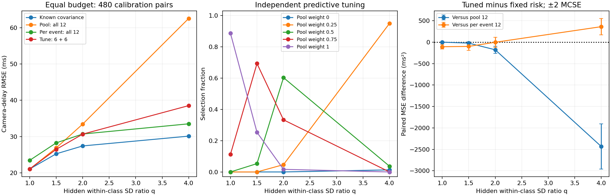

# Partial pooling for optical camera timing

A **45–60 minute lab** linking optical image formation to camera sampling, subpixel timing and covariance regularization. Can independently tuned partial pooling beat fixed policies when every method gets the same calibration budget? This extends the held-out covariance-testing lesson with continuous-strength candidates and predictive selection rather than a hypothesis-test decision.

## Learn and run

Objectives: derive the sampled spot, recover exposure time, derive a mean-free validation score, select covariance pooling strength without seeing evaluation data, and compare downstream delay risk at equal acquisition cost. Prerequisites: covariance matrices, Gaussian likelihood, least squares, basic Fourier optics and Python.

```sh
git clone https://github.com/ahmetalpkilic/partial-pooling-optical-timing-learning-lab.git
cd partial-pooling-optical-timing-learning-lab
sh run_demo.sh
```

Python 3.9–3.12 and a POSIX shell required. The runner creates `.venv`, installs pinned dependencies, runs 13 tests, and writes `outputs/results.json` and `outputs/experiment.png`. First installation needs internet; subsequent `.venv/bin/python lab.py` runs offline. All images and data are synthetic. Reference outputs are in `examples/`. Fixed seeds reproduce results in the pinned environment; floating-point/library differences can affect final digits elsewhere.

Spend 10 minutes on the optical model, 10 on the score derivation, 10 running and reading plots, 10 inspecting data separation, and 5–20 on exercises.

| Area | Model | Why it matters |
|---|---|---|
| Optics | Fourier transform of a 550 nm Gaussian pupil | Determines the diffraction spot width |
| Camera | 16 mm lens, 4 µm integrated pixels, Gaussian read noise | Determines the sampled localization signal |
| Vision/metrology | Subpixel spot fitting and known motion | Maps a camera image into exposure time and clock delay |
| Mathematics | Convex covariance pooling, held-out likelihood, profiled clock regression | Trades covariance estimation variance against model mismatch |

## Physical model and conventions


The pupil amplitude is `exp(-(rho_x²+rho_y²)/a²)`, with amplitude radius `a=1000 µm`, wavelength `lambda=0.550 µm`, and focal length `f=16000 µm`. This is an **untruncated Gaussian pupil**, not a uniform circular aperture or an f-number model. Scalar paraxial monochromatic Fourier optics, an aberration-free isolated point and instantaneous exposure are assumed.

The Fourier amplitude is proportional to `exp(-(pi*a*x/(lambda*f))²)`. Squaring gives intensity SD `lambda*f/(2*pi*a)`. At pixel pitch `p=4 µm`,

```text
sigma_px = lambda*f/(2*pi*a*p) = 0.350140875 px
mu_j(u) = B + F [Phi((j+0.5-u)/sigma) - Phi((j-0.5-u)/sigma)]
```

`Phi` is the standard-normal CDF; `F=10000 ADU`, `B=20 ADU`. The camera has square pixels, no distortion/skew, principal point `(0,0)` and `K=diag(4000,4000,1)` in pixels. We simulate the horizontal marginal of a separable 2-D PSF. Signed ROI pixel centers are `j=-16,...,+16`, increasing to the right; each integrates `[j-0.5,j+0.5]`. These are not top-left array coordinates.

Each marginal sample receives independent Gaussian read noise of SD 2 ADU. There is no shot noise, saturation, quantization, or photometry fitting; flux, background and optical width are known. Least squares fits `u` using the analytic pixel-integral derivative. This high-SNR toy model isolates clock uncertainty, not a full camera noise budget.

The independently known image trajectory is `u(r)=u0+v*r`, `u0=0.23 px`, `v=0.8 px/reference second`. Clocks obey `r=alpha*t+beta`: true `alpha=1.002 reference s/master s`, `beta=0.030 reference s`. A frame tagged `T=2.0 master s` was exposed at `T+delta`, with true delay `delta=0.040 master s`.

Forty synchronization events span `[-1,+1] master s`. The true event times are **withheld from the estimator**. Even events have timestamp SDs `(0.030,0.020) s`, correlation 0.5. Odd events have SDs `(0.240,0.020*sqrt(8)) s`, correlation 0.2. The base class heterogeneity is fixed at `h=8`. Covariances have units s². Calibration is extrapolated to the frame time beyond the sync interval.

The new sensitivity factor `q=1,1.5,2,4` multiplies BOTH timestamp standard deviations for half the events **within each class**. Correlations stay fixed; thus `C_i(q)=s_i² C_class`, where `s_i=q` if `floor(i/2)` is odd and 1 otherwise. Classes are known from the experimental design (`i mod 2`), not inferred from evaluation residuals. At q=1 pooling is correctly specified; at q>1 the two labels hide four actual noise populations. Training and evaluation have the same per-event covariance: this is class mismatch, not temporal distribution shift.

## Partial pooling and independent tuning

For each of 40 synchronization events, acquire **12 calibration timestamp pairs**. Each pair contains master-clock and reference-clock seconds. These are calibration repeats of a fixed event, independent of the final synchronization observations. Use six repeats for training and six for validation. The simulation draws image noise, final timestamps, training repeats and validation repeats from four independent seeded streams. Unknown event times enter the simulator but never the selector or clock fitter.

For event i and training count m=6, subtract that event's own repeat mean:

```text
S_i = sum_k (w_ik - mean_i)(w_ik - mean_i)^T / (m-1)
P_i = mean_{j in class(i)} S_j
A_i(w) = (1-w) S_i + w P_i,    w in {0, .25, .5, .75, 1}.
```

Each class contains 20 events with equal repeat count. Pooling raw timestamp values would confound different event times with clock noise. These matrices estimate covariance of **one** timestamp pair; do not divide by m. w=0 means per-event covariance; w=1 means full class pooling. For any nonzero vector x, `x^T A x=(1-w)x^T S x+w x^T P x > 0`, so the convex mixture stays positive definite. No ridge is hidden in the implementation.

Construct three disjoint validation differences per event:

```text
d_ij = (v_i,2j+1 - v_i,2j) / sqrt(2),  j=0,1,2.
E[d_ij]=0; Cov[d_ij]=(C_i+C_i)/2=C_i.
```

The unknown event mean cancels exactly. Independence and equal covariance within each event's repeats are essential. Overlapping differences would be correlated; they are not used. There are 120 independent bivariate differences in the score. In declared second coordinates, the twice-negative Gaussian log density, omitting a constant, is

```text
L(w) = mean_{i,j} [ log det A_i(w) + d_ij^T A_i(w)^(-1) d_ij ]
w_hat = argmin L(w).
```

This follows directly from the [multivariate Gaussian density](https://docs.scipy.org/doc/scipy/reference/generated/scipy.stats.multivariate_normal.html). `lab.py::score` uses a linear solve, not an explicit inverse. Exact ties choose the larger pooling weight. The log determinant is relative to the fixed numerical second coordinates; changing timestamp units adds a candidate-independent constant and transforms quadratic terms consistently, so the selected weight is invariant.

Conditional on training data, expected score is `mean_i [log det A_i + tr(A_i^-1 C_i)]`. Subtracting the score at C_i gives twice the mean Gaussian KL divergence. To see nonnegativity, diagonalize `A_i^-1/2 C_i A_i^-1/2`: each eigenvalue contributes `lambda - log(lambda) - 1 >= 0`. Predictive tuning targets covariance quality, **not camera-delay MSE**. It can therefore select weights that are suboptimal for the downstream task. The finite validation score used to choose a candidate is optimistically selected; no generalization claim is based on its minimum.

The selected training matrix is retained without refitting on validation. The final 40 timestamp pairs and noisy camera image are freshly generated and excluded from tuning. Every outer trial redraws all four streams. Common standard normals pair q levels, and all methods share the same final image and timestamps, reducing comparison noise; curve points are consequently correlated.

### Equal acquisition budgets and diagnostic controls

| Policy | Covariance estimation | Selection | Total acquired pairs |
|---|---|---|---:|
| Tuned 6+6 | Six repeats/event | Six independent repeats/event | 480 |
| Pool 12 | All 12 repeats/event pooled by class | None | 480 |
| Per event 12 | All 12 repeats/event per event | None | 480 |
| Pool 6 / per event 6 | First six repeats only | None | 240 |
| Known covariance | Simulation truth | None | Oracle, not a feasible budget competitor |

The six-repeat endpoints are diagnostics in JSON, excluded from the equal-budget plot. Fixed 12-repeat methods can use the tuning samples because they make no data-driven choice. The tuned method pays explicitly for its held-out split. All feasible methods also use the same 40 independent final timestamp pairs, and one final camera image; those evaluation costs are common and excluded from the calibration-budget column.

The controlled sensitivity is hidden within-class noise SD ratio q=1,1.5,2,4. The q=1 case supports full pooling; larger q violates the shared class-covariance assumption. One global w is selected for both classes; the experiment does not discover new classes. There are 300 outer trials. JSON reports bias, SD, RMSE and paired squared-error differences versus both 12-repeat policies. For errors in ms,

```text
D_t = e_tuned,t^2 - e_fixed,t^2
MCSE(mean D) = sample_SD(D) / sqrt(300).
```

The right plot shows mean D ± 2 MCSE, an approximate Monte Carlo uncertainty display for risk differences, not a confidence interval for any device's delay. Negative means favor tuning. RMSE is not substituted into this paired formula. Selection frequency likewise is descriptive Monte Carlo output, not certainty about an optimal weight.

### From covariance to optical delay


Treat `S_i` as a plug-in covariance, temporarily fixed during each fit. With latent true time `tau_i`, minimize

```text
Q = sum_i [z_i-(tau_i,alpha*tau_i+beta)]^T S_i^-1
          [z_i-(tau_i,alpha*tau_i+beta)]
```

For `d=(1,alpha)`, differentiation gives

```text
tau_i* = d^T S_i^-1 (x_i,y_i-beta) / (d^T S_i^-1 d).
V_i(alpha) = alpha²*S_i,xx - 2*alpha*S_i,xy + S_i,yy
Q_profile = sum_i (y_i-alpha*x_i-beta)²/V_i(alpha)
beta*(alpha) = sum_i [(y_i-alpha*x_i)/V_i] / sum_i [1/V_i].
```

Search numerically over `alpha in [0.5,1.5]`. The implementation checks a 65-point grid, refines bracketed minima and rejects boundary/flat fits. This is not a global-optimum guarantee for arbitrary data. Independent full latent-event optimization validates the implemented objective. There is no `log V_i` term: this profiles fixed latent times; it does not marginalize random times. With estimated covariance, this is a **plug-in procedure**, not the full likelihood jointly accounting for covariance uncertainty. We make no confidence-interval or coverage claim.

Finally,

```text
r_hat = (u_hat-u0)/v
 delta_hat = (r_hat-beta_hat)/alpha_hat - T
 d(delta) ≈ du/(v*alpha) - d(beta)/alpha - (T+delta)*d(alpha)/alpha.
```

Thus precise optical localization can coexist with poor delay precision when calibration weights are uncertain and rate errors are extrapolated.

Here `S_i` is the covariance assigned to event i by the selected policy, including the partial mixture `A_i(w)`. The known-covariance oracle uses `C_i` instead.

## Expected results

| Hidden SD ratio q | Pool 12 RMSE (ms) | Per-event 12 RMSE (ms) | Tuned 6+6 RMSE (ms) |
|---:|---:|---:|---:|
| 1.0 | 21.015 | 23.429 | 21.043 |
| 1.5 | 26.861 | 28.250 | 26.456 |
| 2.0 | 33.426 | 30.694 | 30.663 |
| 4.0 | 62.584 | 33.509 | 38.531 |

At q=1, 100% pooling is selected in 266/300 trials. At q=4, tuned pooling improves on full pooling, but spending all 12 repeats on per-event covariance yields lower delay RMSE. The held-out score addresses covariance prediction; its split has a real acquisition cost. This run does not establish universal superiority of either policy. All fits succeeded. Optical center SD is 0.0002820 px; PSF SD is 0.350140875 px. See JSON for paired risk MCSE and six-repeat controls.




## Annotated code and validation

Read `optics.py` for pupil-derived PSF and pixel integration, `clock_model.py` for latent-time elimination, `pooling.py` for within-event scatter, then the short `mix`, `differences`, `score`, `tune` and `experiment` functions in `lab.py`. The selector's API accepts only training and validation repeats: no known covariance, q, final camera center or final timestamp observations.

Thirteen tests validate the independent pupil FFT, pixel integral by quadrature and derivative by finite differences, noiseless delay recovery, independent generalized-eigenvalue and full latent-event fits, coordinate transformations, and invalid clock fits. New checks compare the score against SciPy's Gaussian log density, verify difference covariance using 10,000 independent pairs/event, show mean/units invariance, check convex endpoints and positive definiteness, validate the population score against wrong scales, and exercise end-to-end optical timing with an independent seed. The demo stops on any failed fit rather than reporting precision conditional on success.

## Exercises

1. Derive the expected score and prove its minimum is the true covariance using the scalar inequality `x-log(x)-1 >= 0`. Explain why this does not prove minimum delay RMSE.
2. Change the split to 4+8 and 8+4 while keeping 12 total repeats and an even validation count. Compare risk with independent seeds; do not pick a split on the final evaluation results and call that an unbiased result.
3. Add w=0.125 and w=0.875. Predict how a larger candidate set changes selection variability, then measure it with a new evaluation seed.
4. Change the frame time from 2 s to 0 s and regenerate the optical center consistently. Explain how reduced clock extrapolation changes the value of covariance tuning.
5. Correlate repeated timestamp noise within each event while preserving marginal covariance. Derive the altered difference covariance and demonstrate why the present validation score becomes miscalibrated.

## Limits and next lesson

Independent Gaussian repeat errors, known class labels, affine clocks, stationary per-event noise, and independently known optical parameters, photometry and motion are assumed. The optical model omits shot noise, finite exposure, aberration and sensor nonlinearities. Small training samples can still yield poorly conditioned matrices; the clock fit explicitly rejects such cases. Grid-bracketed clock optimization is numerically checked, not guaranteed globally optimal for arbitrary data. Plug-in covariance tuning accounts for uncertainty empirically across simulation trials, not through a joint likelihood or interval-coverage guarantee. A single global pooling weight and coarse candidate grid are deliberate simplifications. Synthetic repeatability and numerical recovery do not establish instrument accuracy or traceability.

Next focused lesson: cross-fit covariance tuning so each calibration repeat can contribute to estimation while selection remains out of fold; compare fixed total budgets and evaluate fresh optical-delay risk. Keep that distinct from today's retained holdout split.

## Sources and attribution

New partial-pooling/tuning code, documentation additions and synthetic outputs are MIT, copyright 2026 ahmetalpkilic. `optics.py`, `clock_model.py`, `pooling.py`, `test_clock_model.py`, the runner and dependency pins are reused from the [held-out predecessor at 37fb092](https://github.com/ahmetalpkilic/held-out-covariance-validation-learning-lab/tree/37fb0928667a058cbc41e26998d3e38c69a2ec36). Physical and clock-model explanations are adapted from that README. Its license and earlier predecessor licenses are preserved in `licenses/`.

Current public prysm (MIT, optics context only), NumPy/SciPy (BSD-3-Clause), Matplotlib (permissive license agreement), and the predecessor were reviewed. `sources.json` records retrieved commits, commit descriptions, activity dates, archive status, and commit-pinned license URLs; full license texts are retained. [prysm's primary documentation](https://prysm.readthedocs.io/en/stable/) provides broader diffraction/image-chain context. No prysm implementation is copied or executed. Runtime pins differ from reviewed upstream revisions; distributions retain their bundled third-party notices. API dates are recorded as reported, not evidence of independently verified elapsed activity.
